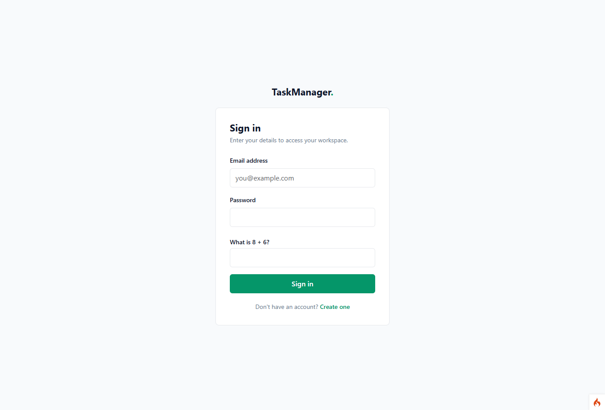
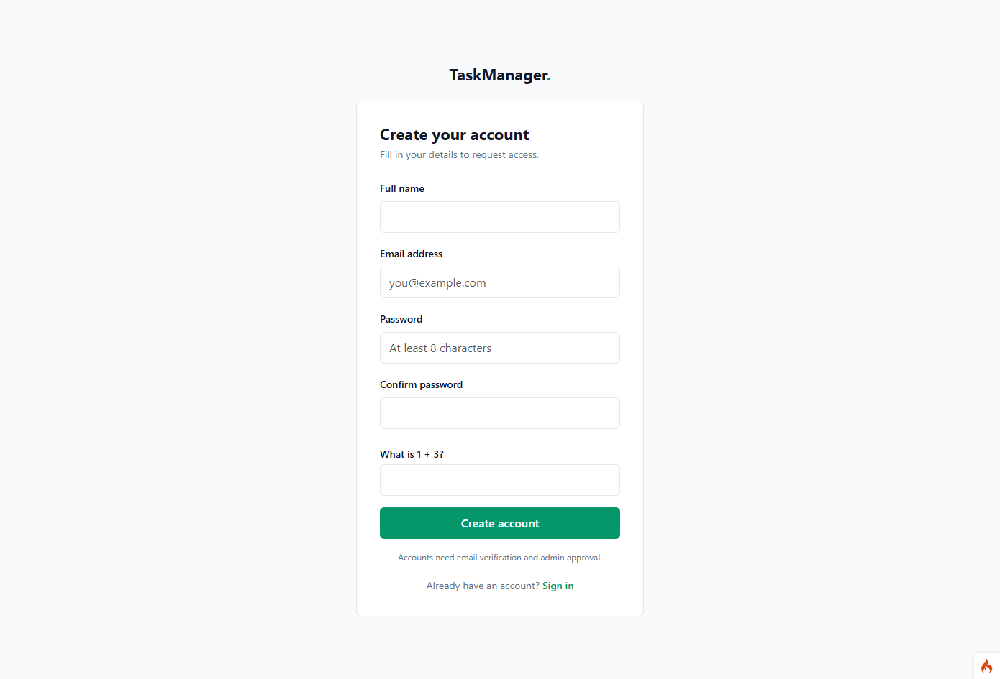
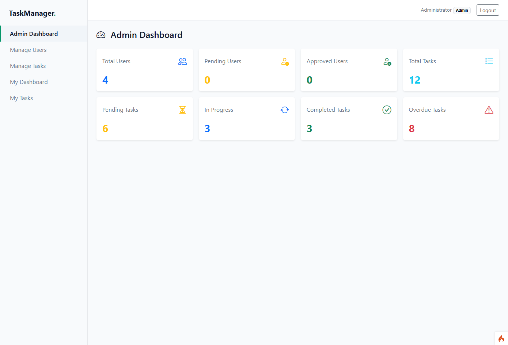
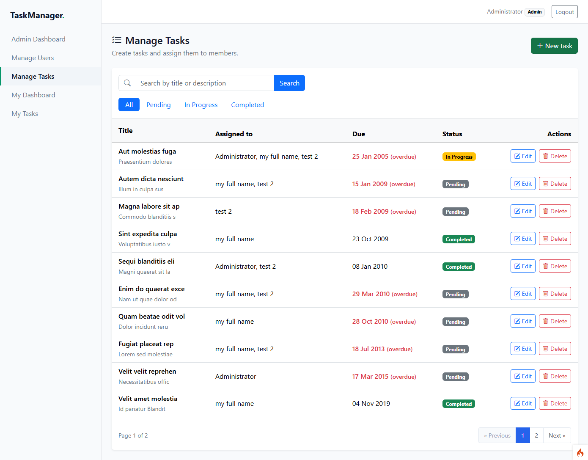

# TaskManager

A task management application built with **CodeIgniter 4, PHP, and MySQL**. It has separate admin and member areas for managing users, creating and assigning tasks, and tracking progress.

## Screenshots

Add your actual application screenshots to the `screenshots/` directory.

### Login



### Registration



### Admin Dashboard



### Manage Tasks



## Features

### Authentication and security
- Registration, login, and logout
- Password hashing and session-based authentication with session ID regeneration
- Role-based access control (Admin and Member) using route filters
- Only active accounts can sign in
- Custom CAPTCHA and honeypot protection on login and signup
- Input validation

### Admin
- Dashboard with user statistics and task statistics (total, pending, in progress, completed, overdue)
- **User management:** search, paginated list, edit, change status, delete
- **Task management:** create, edit, and delete tasks
- Assign a task to multiple members
- Search and filter tasks by status, with paginated lists

### Member
- Dashboard with statistics for assigned tasks and upcoming due dates
- View tasks assigned to you, with search, status filter, and pagination
- Update the status of your assigned tasks

### Tasks
- Title, description, and due date
- Statuses: Pending, In Progress, Completed
- Overdue tracking
- Database transactions when saving a task and its assignees

## Tech stack

PHP 8.2+, CodeIgniter 4, MySQL, Bootstrap 5. Structured as MVC with a repository layer for task operations.

## Setup

Requires PHP 8.2+, Composer, and MySQL or MariaDB.

```bash
git clone https://github.com/hemrajpal/codeignitor-taskmanager.git
cd codeignitor-taskmanager
composer install
cp env .env        # Windows: copy env .env
```

Set your database details in `.env` and create the database, then run:

```bash
php spark migrate
php spark db:seed AdminSeeder
php spark serve
```

Open `http://localhost:8080`.

The seeder creates an admin account: `admin@example.com` / `12345678`. Change this password before deploying.

## Author

**Hemraj Pal**: [github.com/hemrajpal](https://github.com/hemrajpal)

## License

MIT